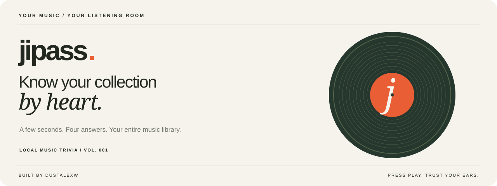

<p align="center">
  
</p>

<p align="center">
  <a href="#your-music-stays-yours"></a>
  <a href="#press-play"></a>
  <a href="#press-play"></a>
</p>

<p align="center">
  <a href="#press-play"><b>Start playing</b></a>
  &nbsp;·&nbsp;
  <a href="#bring-your-collection"><b>Connect your library</b></a>
  &nbsp;·&nbsp;
  <a href="docs/guide.md"><b>Full guide</b></a>
</p>

# jipass

You know the opening riff. You know the voice. Can you name it before the clock runs out?

**jipass** turns your own music collection into a music trivia game. Pick a genre or artist,
hear a short clip, and choose from four answers drawn from your library. A cream, forest-green
and orange listening room, complete with spinning records, album reveals and a little
friendly pressure.

```text
Bring your music → Pick a category → Hear the clip → Trust your ears
```

* **Your collection is the question bank.** Connect multiple mounted NAS folders or local music folders. Incremental rescans skip unchanged files.
* **Find your groove.** Browse genres, search artists, or shuffle the whole library. Genre rounds can mix artist and song-title questions; artist categories test their songs.
* **Four answers. All real.** Wrong answers come from your own library, preferring the same artist or genre where possible. Duplicate and ambiguous answer labels are filtered out.
* **Fast ears get rewarded.** Random clip starts, automatic playback, configurable rounds, keyboard answers and a clock that starts only when playback is ready.
* **Make the reveal count.** Correct/incorrect feedback, speed bonuses, streaks and local album artwork after each guess.
* **Keep your own scoreboard.** Local player profiles, history, accuracy, response times and personal bests survive a restart.
* **Make it yours.** Artist photos with credits, plus artist and genre image uploads through **Settings → BIG CHIEF'M (Debug)**.
* **Try it before connecting anything.** Settings includes a clearly labeled demo with 18 original, locally generated musical sketches.

## Press play

Requires **Python 3.9+** and **FFmpeg**, including `ffprobe`, on your PATH. No Python packages,
frontend build, account or API key required. Node.js is needed only for the JavaScript tests.

Install FFmpeg with `brew install ffmpeg` on macOS or `sudo apt install ffmpeg` on Debian/Ubuntu.
On Windows, install Python and FFmpeg and add both to PATH.

```sh
git clone https://github.com/dustalexw/jipass.git
cd jipass
python3 app.py
```

Open **[127.0.0.1:8765](http://127.0.0.1:8765)** in your browser. On Windows, use `py -3 app.py`
if `python3` is unavailable.

The game starts in library mode. To test without music, open the gear-shaped **Settings**
button and enable **Demo mode**. The demo uses original sketches rather than commercial songs.

To restart, press **Control+C** in the running terminal, run `python3 app.py` again, and refresh
your browser. Your library index and scores remain saved.

## Bring your collection

1. Mount your NAS share through your operating system, or use a local music folder.
2. Open **Library settings**, enter its mounted path and click **Add folder**.
3. Add any other folders, then choose **Rescan all folders**.
4. Pick a category, create a player and start a round.

Examples: `/Volumes/Music` on macOS, `/mnt/nas/music` on Linux, or `Z:\Music` on Windows.
NAS credentials stay with your operating system. jipass reads the mounted files through its backend.
Removing a folder from jipass never deletes the music.

MP3, FLAC, M4A, AAC, Ogg, Opus, WAV, AIFF, WMA, ALAC and APE are supported through FFmpeg.
Missing tags receive sensible fallbacks; unavailable folders keep their existing index.

Prefer configuration in your launch command?

```sh
NEEDLE_MUSIC_DIR="/Volumes/Music" python3 app.py

# Multiple folders
NEEDLE_MUSIC_DIRS='["/Volumes/Music", "/Volumes/OtherMusic"]' python3 app.py
```

The `NEEDLE_*` names are retained from the game's original name for compatibility.
See the [full guide](docs/guide.md#connect-your-nas) for ports, data storage, overlapping folders and rescanning.

## Every second counts

A correct answer before the deadline earns:

```text
500 points + round(500 × (1 − response time ÷ clip duration))
```

A faster correct answer earns a larger bonus. Incorrect answers and timeouts earn **zero**.
The timer waits for playable audio and successful playback; pausing does not stop it.
Use the answer buttons or keys **1–4**. Each round ends with accuracy, average response time,
total score and your personal best.

Questions need four distinct answer labels from the selected source library. If artist
questions cannot offer four known artists, mixed mode explains the limitation and uses titles.
Tracks never repeat within a round.

## Your music stays yours

Music, NAS paths, credentials, scores and gameplay data stay local. The backend binds to
loopback, prepares metadata-free clips and keeps correct answers hidden until a guess or timeout.
There is no browser CDN or telemetry.

**Artist photos are the one external lookup:** artist names are sent to Wikipedia/Wikimedia,
then images and credits are cached locally. Album covers come only from your music files or
nearby album images. Your uploaded category pictures stay local too.

Personal data lives in `data/`, which is excluded from Git. Back it up while the server is
stopped to preserve your library, profiles, history and custom images. This is a casual,
single-computer game; keep it on localhost rather than exposing it through a public proxy.

## Under the record sleeve

| Part | What it does |
| --- | --- |
| Python standard-library server | Local API, indexing, rounds, answers and scoring |
| FFmpeg / ffprobe | Metadata, playable clips and artwork extraction |
| SQLite | Profiles, library, settings and game history |
| Plain JavaScript + CSS | Responsive listening room, playback and feedback |

Run the focused checks from the project folder:

```sh
python3 -m unittest discover -s tests -v
node --test tests/test_ui.cjs
```

The suite covers answer generation, scoring, playback timing, incremental indexing, artwork,
mixed rounds, settings and Debug-gated image uploads. See the [full guide](docs/guide.md)
for detailed behavior, image credits, storage and operating limits.

---

**Your music. Your machine. One more round.**
